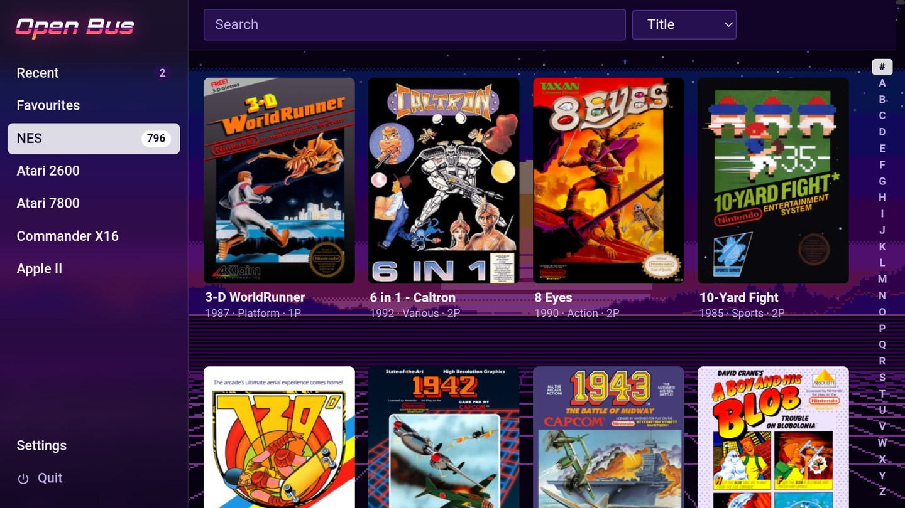
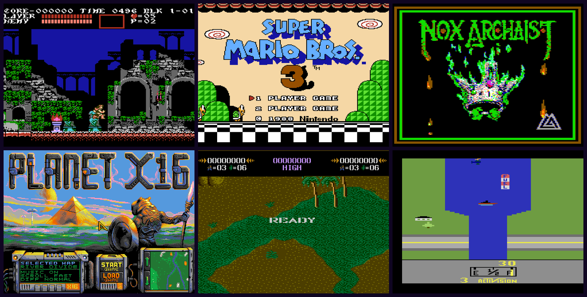

# Open Bus

Old machines, emulated cycle by cycle from the 6502 up. One Rust emulator runs
every machine, and a game library sits in front of it. The library works on
the desktop, on Android TV, and in a web browser.

**[Play it in your browser](https://obus.tuxprint.com/)**: nothing to
install. Add your own games and it runs them.





| Machine               | What's there                                                                                                                                                                                           |
| --------------------- | ------------------------------------------------------------------------------------------------------------------------------------------------------------------------------------------------------ |
| **NES and Famicom**   | NTSC and PAL, over 70 iNES mappers, the Famicom Disk System, the Zapper, and expansion sound (VRC6, Namco 163, MMC5, FDS)                                                                              |
| **Apple II+ and IIe** | Original or enhanced IIe; Disk II with `.dsk`, `.do`, `.po`, `.nib` and `.woz`; a hard disk card; Mockingboards; a clock card; a Super Serial Card with a Hayes modem that dials BBSes on the internet |
| **Atari 2600**        | The common bank-switching schemes, NTSC and PAL                                                                                                                                                        |
| **Atari 7800**        | MARIA, POKEY cartridges, and 2600 games as the 7800 plays them                                                                                                                                         |
| **Commander X16**     | 65C02 at 8 MHz, VERA video and sound, the YM2151, an SD card, the mouse, the RTC, and SNES pads                                                                                                        |
| **Skink**             | A small 6502 computer of our own, built to run GeckOS                                                                                                                                                  |
| **BASIC**             | A bare 6502 with Microsoft BASIC in a terminal                                                                                                                                                         |

Every machine has save states, rewind (held), fast-forward, controls you can
rebind, and a menu that works with just a gamepad.

No games, BIOS files or system ROMs come with Open Bus. You add your own.

[docs/machines.md](docs/machines.md) covers each machine in detail: the files
it needs, its controls, and what isn't supported yet.
[docs/architecture.md](docs/architecture.md) explains how the code fits
together, for anyone changing it.

## Cycle accuracy

The 6502 core is cycle-accurate. It makes one bus access per cycle, every read
and write the real chip makes, including the dummy ones. Each machine sees
those accesses in order and clocks its other chips by them, so interrupt
timing, DMA and mid-instruction effects come out as on hardware, with no
special cases.

The core is checked against Tom Harte's SingleStepTests, which compare every
cycle's bus access for the NMOS 6502, the Synertek, Rockwell and WDC 65C02s,
and the NES's 2A03. Klaus Dormann's functional and decimal tests run too.

How finely the rest of each machine runs:

- **NES:** the PPU runs dot by dot, three dots per CPU cycle. Mappers see
  every fetch, as scanline counters need. It passes nestest and blargg's CPU,
  PPU, APU, timing and MMC3 suites, and 140 of AccuracyCoin's 147 tests.
- **Atari 2600:** the TIA runs a color clock at a time, three per CPU cycle.
  Register writes land with the chip's own delays, so games that race the
  beam draw correctly.
- **Atari 7800:** MARIA builds each line by DMA and takes the CPU's cycles as
  the real chip does, so games run at their true speed.
- **Apple II:** the Disk II's sequencer runs from its PROM twice per CPU
  cycle, reading the disk bit by bit. Copy-protected `.woz` disks load as
  they did on the real drive. Reads of unmapped addresses return the
  floating bus, the byte the video circuit last fetched.
- **Commander X16:** VERA draws a line at a time, as the real one renders
  ahead of the beam. The YM2151's slower bus costs the CPU its wait states.

## The app

The library shows your games by system. It fills in covers and details (year,
genre, players) from libretro's database, and it groups the versions of a game
onto one tile. Games run in the native emulator, in a window of their own.

- **Desktop** (Linux and Windows; macOS untested): a [Tauri](https://tauri.app) app in
  `desktop/`.
- **Android TV**: the same app, built for Android. It's made for a gamepad and
  the TV remote.
- **Web**: the emulator compiled to WebAssembly, with the library as a page,
  at [obus.tuxprint.com](https://obus.tuxprint.com/). It runs everything
  except Skink and BASIC.

Some systems need files of your own, which you add in Settings → System:

- **Apple II**: the machine's ROMs. Add a folder of them and the library sorts
  them out.
- **Famicom Disk System**: `disksys.rom`.
- **Commander X16**: the official ROM. The desktop app can download it for you.

## Keys

| Key              | Action                                    |
| ---------------- | ----------------------------------------- |
| Arrows, X, Z     | D-pad, A, B                               |
| Enter, Tab       | Start, Select                             |
| S, A             | Turbo A, turbo B                          |
| F1               | Menu (on a gamepad, tap Select and Start) |
| F2 / F4          | Save state / load state                   |
| Backspace (held) | Rewind                                    |
| \` (held)        | Fast-forward                              |
| F3               | Debug panel: speed, host load, the CPU    |
| F5               | Back to the library (on a gamepad, Guide) |
| F6               | Change the controls                       |
| F11              | Fullscreen (on a Mac, Ctrl+Cmd+F)         |
| F12              | Reset                                     |

Machines use some function keys for themselves. For example, F9 and F10 change
the Apple's disks and F9 flips a Disk System disk. On the Ataris, F7 and F8
are the difficulty switches, and F9 is the 2600's colour switch or the 7800's
Pause button.

## Building

Everything is Rust (edition 2024), built in release mode. Debug builds are
far too slow to play.

### The emulator

```sh
cargo build --release
target/release/cpu_emu --help
```

SDL 2.32 is built into the program, which needs CMake and a C compiler. On
Linux it also needs the X11, Wayland and sound headers so SDL can use them;
installing `libsdl2-dev` (or your distro's equivalent) brings them all. The
ARM handheld build is the exception: it links to the device's own SDL.

Run a game directly:

```sh
cpu_emu nes "Some Game.nes"
cpu_emu apple2e roms/apple2 "Some Disk.woz"
cpu_emu x16 --game GAME.ZIP
```

`cpu_emu <machine> --help` lists each machine's options.

### The desktop app

You need the Tauri CLI (`cargo install tauri-cli`).

```sh
cargo build --release              # the emulator the app runs
cd desktop && cargo tauri dev      # run the app from here
tools/build-desktop                # or build installers into desktop/target/release/bundle/
```

### The web page

You need [wasm-pack](https://rustwasm.github.io/wasm-pack/) and the
`wasm32-unknown-unknown` target.

```sh
tools/build-web
python3 -m http.server -d web
```

Open it from the server. A page opened as a file can't load WebAssembly.

### Android

```sh
JAVA_HOME=/path/to/jdk-17 tools/build-android arm64-v8a
```

You need the Android SDK in `~/Android/Sdk` and an NDK older than 27. The
script's header lists the rest. The APK lands in
`desktop/gen/android/app/build/outputs/apk/universal/`. Release builds are
signed with the key that `desktop/gen/android/keystore.properties` names, or
the debug key without it; see
[the release key](docs/architecture.md#the-android-release-key).

### Handhelds

`tools/build-handheld` cross-builds for 64-bit ARM Linux handhelds such as the
RG351MP, inside a Docker container. `--launched` makes the emulator behave
under EmulationStation: hold Select and Start together to go back to it.

## Tests

```sh
cargo test
tools/fetch-harte && cargo test --release harte    # Tom Harte's 6502 family tests
tools/fetch-dormann && cargo test dormann          # Klaus Dormann's 6502 tests
```

## Credits

- NES boards follow [Mesen](https://github.com/SourMesen/Mesen2). Its game
  database, `MesenNesDB.txt` (GPL-3), fixes bad iNES headers; it's built from
  NewRisingSun's NES 2.0 database, NesCartDB and Nestopia's.
- The Commander X16 follows its Programmer's Reference and
  [x16emu](https://github.com/X16Community/x16-emulator) (BSD-2).
- The 7800 follows a7800, and the Super Serial Card's switches follow MAME
  (BSD-3).
- Covers and game details come from
  [libretro](https://github.com/libretro)'s thumbnails and database. Apple II
  title screens come from the Internet Archive. They're fetched when asked
  for, never bundled.
- BASIC is mist64's [msbasic](https://github.com/mist64/msbasic) (BSD-2),
  fetched by `tools/fetch-msbasic`.
- The test suites are Tom Harte's
  [SingleStepTests](https://github.com/SingleStepTests) (MIT) and Klaus
  Dormann's [6502 tests](https://github.com/Klaus2m5/6502_65C02_functional_tests)
  (GPL-3).
- The title font is [Orbitron](https://fonts.google.com/specimen/Orbitron)
  (SIL Open Font License).

## License

Open Bus is licensed under the GNU General Public License, version 3 or later.
See [LICENSE](LICENSE).
